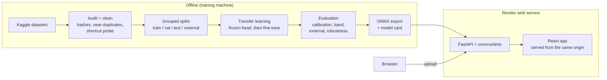

# AI-Generated Image Detection

A web application that estimates whether an uploaded image is a real photograph or AI-generated, using a
transfer-learned convolutional network. It returns a calibrated probability, an explicit **inconclusive**
answer when the model is unsure, and a Grad-CAM heatmap of the regions that drove the score.

> Every number in this README is generated from `artifacts/metrics/*.json` by
> `python -m ml.scripts.update_readme`; a test fails if the README and the metrics files disagree.
> The result is a statistical estimate, not proof of how an image was made.

## Problem and objectives

Image generators (Stable Diffusion, Midjourney, DALL·E, GANs) now produce pictures that people cannot reliably
tell apart from photographs. The project's objectives:

1. Build a clean, leakage-free dataset of real and AI-generated images from several public sources.
2. Fine-tune a pretrained CNN and select the architecture on accuracy, generalisation to unseen generators,
   false-positive rate, size and CPU latency.
3. Report honest metrics: held-out test split, external sources never used in training, and robustness to
   compression, resizing, cropping, screenshots and edits.
4. Serve the model in a production web application with explanations, and deploy it on Render.

## System architecture



| Layer | Technology | Where |
|---|---|---|
| Data pipeline | Pillow, imagehash, pandas, scikit-learn | `ml/datasets`, `ml/preprocessing` |
| Training | PyTorch (Apple MPS / CUDA / CPU), timm | `ml/training` |
| Evaluation | scikit-learn, SciPy, matplotlib | `ml/evaluation` |
| Shared preprocessing | Pillow + NumPy (used by training *and* serving) | `detector_core/preprocess.py` |
| Backend | FastAPI, onnxruntime (CPU), pydantic-settings | `backend/app` |
| Frontend | React, TypeScript, Vite; hand-built SVG charts | `frontend/src` |
| Deployment | Render web service (`render.yaml`) | repo root |

The API contract shared by all layers is [`docs/contract/api.md`](docs/contract/api.md). The detailed
methodology for the viva is in [`docs/methodology.md`](docs/methodology.md).

## Datasets

| Dataset | Licence | Use |
|---|---|---|
| [DeepDetect-2025](https://www.kaggle.com/datasets/ayushmandatta1/deepdetect-2025) | Apache-2.0 | training pool (faces) |
| [AI Detection Dataset](https://www.kaggle.com/datasets/malaxmels/ai-detection-dataset): Midjourney, DALL·E, Stable Diffusion vs Pexels/Unsplash/WikiArt | see Kaggle page | training pool (general content), class-balanced subset |
| [Labeled Deepfake Image Collection](https://www.kaggle.com/datasets/jayanthbottu/labeled-deepfake-image-collection) | see Kaggle page | external test only, per generator |
| [MidJourney ImageNet: Real vs Synth](https://www.kaggle.com/datasets/mariammarioma/midjourney-imagenet-real-vs-synth) | see Kaggle page | external test only (matched protocol) |

Downloads use the official Kaggle CLI/API (`ml/scripts/download_with_resume.sh`, `ml/datasets/parallel_resume.py`)
with resume, stall detection and an MD5 check. Credentials are read from `~/.kaggle/access_token` or
`KAGGLE_API_TOKEN` and never stored in the repository. Raw data lives in `data/raw` and is git-ignored.

### Preparation results

<!-- generated:dataset -->
179,920 images audited, 175,100 kept, 4,820 removed (conflicting label 1,506, exact duplicate 293, external leak 3,018, unsupported format 3). Leakage check across splits: 0 exact and 0 near-duplicate leaks.

| Source | Real | AI-generated | Domain | Role |
|---|---|---|---|---|
| ai_detection | 23,970 | 23,969 | general | train pool |
| deepdetect | 56,759 | 50,791 | faces | train pool |
| labeled_deepfake | 5,871 | 12,178 | faces | external |
| midjourney_imagenet | 739 | 823 | general | external |

| Split | Real | AI-generated |
|---|---|---|
| train | 56,510 | 52,332 |
| val | 12,109 | 11,213 |
| test | 12,110 | 11,215 |
| external | 6,610 | 13,001 |
<!-- /generated:dataset -->

### What the audit found (and why it matters)

- **The face datasets are almost entirely portraits.** A model trained only on them would be a face detector
  and would give confident, wrong answers on landscapes or objects, so a general-content source was added and
  results are reported per content domain.
- **File-format shortcuts.** Some AI images are PNG or 300×300 while their real counterparts are JPEG at
  256×256. In MidJourney-ImageNet every AI image is a 1024 px PNG and every real image a 200 px JPEG: a
  classifier on file metadata alone reaches ROC-AUC 1.0 there. Training therefore re-encodes uncompressed
  sources once at JPEG quality 95 and applies random JPEG compression to *both* classes, and external results
  are also reported under a *matched* protocol that removes the format and size difference.
- **Cross-source overlap.** 3,018 training images were near-duplicates of the external "real" faces and were
  removed so the external test stays independent.

## Method

- **Cleaning:** unreadable/unsupported files quarantined with reasons; exact duplicates by MD5; near-duplicates
  by 64-bit perceptual hash (Hamming distance ≤ 4, exact multi-band search); clusters mixing both labels dropped.
- **Splits:** 70/15/15, seeded, stratified by source and label, with whole near-duplicate clusters assigned to
  one split. A separate check re-derives the clusters from the hashes and fails the pipeline on any leak.
- **Preprocessing (identical for training and serving):** decode by content, apply EXIF orientation, flatten
  transparency onto white, resize the short side to 256 px, crop 224 px (random for training, centre otherwise),
  ImageNet normalisation.
- **Augmentation (both classes equally):** horizontal flip, mild brightness/contrast, down-and-up resampling,
  JPEG quality 60–95. Rotation, shear and strong blur are deliberately omitted because interpolation removes
  the high-frequency traces the detector relies on.
- **Transfer learning:** ImageNet-pretrained backbone; phase 1 trains only the head (global average pool →
  dropout → one linear logit) on a frozen backbone; phase 2 unfreezes the backbone at a 10× lower learning rate.
  AdamW, cosine schedule with warm-up, class-balanced sampling, early stopping on validation loss, best
  checkpoint kept. The final run of the selected MobileNetV3-Large completed three epochs on all 108,842 training
  images before the host stopped it for lack of memory; its best checkpoint (epoch 3, lowest validation loss) is
  the deployed model, and `python -m ml.scripts.run_experiments evaluate` produced every result below from it.
- **Calibration and abstention:** a temperature fitted on validation calibrates the probability; an
  inconclusive band is chosen on validation so at most 2% of real and 2% of AI validation images fall on the
  wrong side of a verdict.
- **Explainability:** because the head is pool + linear, Grad-CAM equals CAM, `ReLU(Σ_c w_c A_c)`; a test
  proves the equality against autograd, which lets the server compute real heatmaps from the ONNX model alone.

## Results

### Model selection

Two compact candidates were trained under the same budget; the deployed model is chosen on generalisation to unseen
generators, false-positive rate, size and CPU latency as well as validation AUC.

<!-- generated:comparison -->
| Model | Parameters | ONNX size | Validation AUC | Unseen-generator AUC | CPU latency |
|---|---|---|---|---|---|
| efficientnet_b0 | 4.0 M | 15.8 MB | 0.985 | 0.966 | 24 ms |
| mobilenetv3_large_100 | 4.2 M | 11.6 MB | 0.981 | 0.974 | 11 ms |
<!-- /generated:comparison -->

### Held-out test split

<!-- generated:results -->
Model `mobilenetv3_large_100`, held-out test split (n = 23,325), calibrated with temperature 1.246 fitted on validation.

| Metric | Value |
|---|---|
| accuracy | 96.9% |
| precision | 96.7% |
| recall | 96.9% |
| f1 | 96.8% |
| specificity | 96.9% |
| false positive rate | 3.1% |
| false negative rate | 3.1% |
| ROC-AUC | 0.995 |
| PR-AUC | 0.995 |
| log loss | 0.087 |
| ECE (calibration error) | 0.005 |

|  | Predicted real | Predicted AI |
|---|---|---|
| Actually real | 11,736 | 374 |
| Actually AI | 348 | 10,867 |

With the inconclusive band (33.3% to 64.0% probability of AI), the model gives a verdict on 97.7% of test images, 97.8% of which are correct; 543 are inconclusive.
<!-- /generated:results -->

### External sources (never used in training)

<!-- generated:external -->
| Set | Protocol | n | Accuracy | ROC-AUC |
|---|---|---|---|---|
| labeled_deepfake | as_is | 11,858 | 89.9% | 0.977 |
| labeled_deepfake/DALL-E | as_is | 2,000 | 99.1% | n/a |
| labeled_deepfake/Midjourney | as_is | 930 | 99.0% | n/a |
| labeled_deepfake/Stable Diffusion | as_is | 2,098 | 84.7% | n/a |
| labeled_deepfake/StyleGAN | as_is | 959 | 30.0% | n/a |
| labeled_deepfake/real | as_is | 5,871 | 96.9% | n/a |
| labeled_deepfake/face_swap (out of scope) | as_is | 6,191 | 8.2% | n/a |
| labeled_deepfake | matched: AI images resized to 256px and JPEG q95 | 11,858 | 91.6% | 0.982 |
| midjourney_imagenet | as_is | 1,562 | 76.4% | 0.864 |
| midjourney_imagenet/midjourney | as_is | 823 | 80.0% | n/a |
| midjourney_imagenet/real | as_is | 739 | 72.5% | n/a |
| midjourney_imagenet | matched: AI images resized to 220px and JPEG q75 | 1,562 | 67.3% | 0.753 |

- labeled_deepfake: real and AI images differ in file format or resolution; the matched protocol removes that difference and is the fairer number.
- midjourney_imagenet: real and AI images differ in file format or resolution; the matched protocol removes that difference and is the fairer number.
<!-- /generated:external -->

### Robustness

<!-- generated:robustness -->
| Condition | Accuracy | ROC-AUC | False-positive rate |
|---|---|---|---|
| Unmodified test image | 97.1% | 0.995 | 2.8% |
| Re-saved as JPEG quality 90 | 94.8% | 0.990 | 6.2% |
| Re-saved as JPEG quality 70 | 95.9% | 0.991 | 4.3% |
| Re-saved as JPEG quality 50 | 93.9% | 0.984 | 6.0% |
| Re-saved as JPEG quality 30 (heavy compression) | 90.3% | 0.967 | 5.4% |
| Downscaled to 50 % (the model then upsamples it) | 95.1% | 0.988 | 5.5% |
| Downscaled to 25 % | 75.8% | 0.907 | 6.5% |
| Central 60 % crop | 78.5% | 0.956 | 1.9% |
| Screenshot-like: 75 % resample, sharpening, PNG | 96.7% | 0.994 | 2.6% |
| Brightness/contrast edit then JPEG q90 | 94.2% | 0.988 | 7.2% |
| Gaussian blur radius 1 | 95.0% | 0.987 | 2.5% |
<!-- /generated:robustness -->

### Size and speed

<!-- generated:latency -->
ONNX model 11.6 MB; single-image CPU inference p50 11.4 ms, p95 12.3 ms with 1 thread (Darwin arm64 (arm), 50 runs).
<!-- /generated:latency -->

Figures (training curves, confusion matrix, ROC/PR curves, confidence distribution, class distribution,
model comparison) are written to `artifacts/plots/` by `python -m ml.evaluation.plots`.

## Running it locally

Requirements: Python 3.13 and Node.js 22+.

```bash
python3.13 -m venv .venv
.venv/bin/pip install -r requirements-dev.txt          # training + tests; production needs only backend/requirements.txt
npm ci --prefix frontend && npm run build --prefix frontend
.venv/bin/uvicorn backend.app.main:app --port 8000      # http://127.0.0.1:8000
```

For frontend development, run `npm run dev --prefix frontend` (proxies `/api` to port 8000).

### Reproducing the model

```bash
# 1. data (needs a Kaggle token in ~/.kaggle/access_token)
ml/scripts/download_with_resume.sh ayushmandatta1/deepdetect-2025 data/raw/deepdetect
ml/scripts/download_with_resume.sh jayanthbottu/labeled-deepfake-image-collection data/raw/labeled_deepfake
ml/scripts/download_with_resume.sh mariammarioma/midjourney-imagenet-real-vs-synth data/raw/midjourney_external
ml/scripts/download_with_resume.sh malaxmels/ai-detection-dataset data/raw/ai_detection keep-zip
.venv/bin/python -m ml.datasets.extract_subset data/raw/ai_detection/ai-detection-dataset.zip data/raw/ai_detection_subset
# 2. audit, clean, split (writes data/manifests and artifacts/metrics/dataset_report.json)
.venv/bin/python -m ml.scripts.run_audit && .venv/bin/python -m ml.scripts.prepare_data
# 3. compare architectures, then train, evaluate and export the selected one
.venv/bin/python -m ml.scripts.run_experiments compare --config ml/configs/compare.yaml
.venv/bin/python -m ml.scripts.run_experiments final --config ml/configs/final.yaml --arch <selected>
.venv/bin/python -m ml.scripts.update_readme
```

All random choices are seeded (seed 42).

## Testing

```bash
.venv/bin/python -m pytest                                   # data, ML, export and backend suites
.venv/bin/ruff check . && .venv/bin/mypy backend/app --ignore-missing-imports
cd frontend && npm run lint && npm run typecheck && npm run check:contrast && npm test && npm run test:e2e
```

Tests compare against independent oracles (hand-computed values, scikit-learn, brute-force search, direct
onnxruntime calls) rather than the code's own output. Each module was also checked by deliberately breaking it
(`ml/scripts/mutation_check.py`) and confirming a test fails.

## API

| Method | Path | Purpose |
|---|---|---|
| POST | `/api/predict` | multipart `file` (+ `explain=true`) → label, calibrated probabilities, band, heatmap, timings |
| GET | `/api/health` | liveness and model status (503 when the model failed to load) |
| GET | `/api/model` | model card: architecture, version, calibration, training summary |
| GET | `/api/metrics` | every evaluation file in `artifacts/metrics` |

Full request/response shapes and error codes: [`docs/contract/api.md`](docs/contract/api.md).

## Deployment on Render

`render.yaml` defines one Python web service on the Starter plan (0.5 CPU, 512 MB): the build installs
`backend/requirements.txt` and builds the React app; `uvicorn` serves both on Render's `$PORT`, and Render's
health check uses `/api/health`. Training never runs on Render (no GPUs there); the service only loads the
committed ONNX model, so it survives redeploys without a disk. To deploy: push the repository to GitHub, then
in Render choose **New → Blueprint** and select the repository.

## Limitations

- Accuracy on generators, content and post-processing absent from training is lower than on the test split;
  see the external and robustness tables.
- The model sees a 224 px centre crop of the image scaled to 256 px, so detail in large images and content
  outside the centre is not analysed.
- Heatmaps show where the model looked, not which pixels were generated.
- It must not be used as the sole basis for decisions about people.

## Future work

Larger multi-generator training data (e.g. ArtiFact), multi-crop inference over the whole image, frequency-domain
features, and periodic re-training as new generators appear.

## References

- Bird, J. J. and Lotfi, A. (2024). CIFAKE: Image classification and explainable identification of AI-generated
  synthetic images. *IEEE Access*.
- Selvaraju, R. R. et al. (2017). Grad-CAM: Visual explanations from deep networks via gradient-based localization. *ICCV*.
- Zhou, B. et al. (2016). Learning deep features for discriminative localization (CAM). *CVPR*.
- Tan, M. and Le, Q. (2019). EfficientNet. *ICML*; Howard, A. et al. (2019). Searching for MobileNetV3. *ICCV*;
  He, K. et al. (2016). Deep residual learning (ResNet). *CVPR*.
- Guo, C. et al. (2017). On calibration of modern neural networks (temperature scaling). *ICML*.
- Zauner, C. (2010). Implementation and benchmarking of perceptual image hash functions.
- Dataset pages linked in the Datasets table above.
