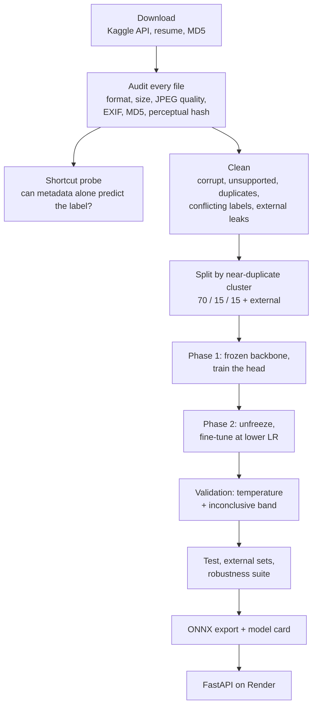

# Methodology (for the project report and viva)

This document explains *why* each step of the pipeline exists. Numbers are deliberately not repeated here; they
live in `artifacts/metrics/*.json` and the generated tables of the README.

## 1. Pipeline at a glance

## 2. Data decisions

**Why several sources?** A detector trained on one dataset learns that dataset's quirks (camera, compression,
subject matter) as much as the difference between real and generated images. Combining a faces dataset with a
general-content one, and keeping two more sources purely for external testing, measures how much of the skill
transfers.

**Why audit before training?** Viewing samples showed that the face datasets are almost entirely portraits, and
the audit showed label-correlated file properties (PNG vs JPEG, 300 px vs 256 px). A model can reach high accuracy
by learning such properties instead of image content. The *shortcut probe* makes this measurable: a
gradient-boosted classifier is trained on file metadata only (format, size, resolution, JPEG quality, EXIF,
mean colour). A ROC-AUC near 0.5 means metadata carries no label signal; a high AUC means preprocessing must
neutralise that property.

**How the shortcuts are neutralised.** Uncompressed training sources are JPEG-encoded once at quality 95 (the
dominant encoding of the other sources); every training image then goes through the same random JPEG compression,
resampling and flips regardless of label; all images are resized to the same scale. For an external set whose
classes differ in format and size, a *matched* protocol brings the AI images to the real images' resolution and
JPEG quality before scoring, and both numbers are reported.

**Duplicates and leakage.** Exact duplicates share an MD5. Near-duplicates (re-saved, resized or slightly edited
copies) share most bits of a 64-bit DCT perceptual hash; images within 4 bits are linked, and linked images form
clusters. The search is exact: splitting the hash into 5 bands guarantees, by the pigeonhole principle, that two
hashes within 4 bits agree on at least one band, so only same-band candidates need comparing. Whole clusters go
to one split, clusters containing both labels are dropped, and training images whose cluster touches an external
image are removed. After splitting, an independent check re-derives the clusters and aborts on any leak.

## 3. Model decisions

**Transfer learning.** ImageNet features (edges, textures, shapes) are a strong starting point even though the
task is different. Phase 1 trains only the new head on a frozen backbone, so the randomly initialised head cannot
damage pretrained weights with large early gradients. Phase 2 unfreezes the backbone with a 10× smaller learning
rate to adapt the features to generation artefacts. Frozen BatchNorm layers stay in evaluation mode so their
statistics are not overwritten by small batches.

**Architecture selection.** Two compact candidates, MobileNetV3-Large and EfficientNet-B0, were trained with the
same short budget (20,000 images, one head epoch and two fine-tuning epochs) and compared on validation AUC, AUC on
unseen generators, false-positive rate, ONNX size and CPU latency. The deployment target is a 0.5-CPU, 512 MB Render
instance, so size and CPU latency matter as much as accuracy. Larger backbones such as ResNet50 (about 90 MB as
ONNX) were left out because they do not suit that instance. Training speed on the Apple-silicon GPU also decided the
choice: MobileNetV3 trains about 4.5 times faster there, which buys more fine-tuning on the full dataset.

**Final training run.** The selected MobileNetV3-Large was trained on all 108,842 training images. The run was
stopped by the host after the third epoch because the laptop ran short of memory; validation accuracy had risen from
75.2% (head only) to 96.2% and 97.1% in the two fine-tuning epochs, and the epoch-3 checkpoint, which had the lowest
validation loss, is the deployed model.

**Head design and explainability.** The head is global average pooling → dropout → one linear output. For this
head Grad-CAM reduces exactly to Class Activation Mapping, `ReLU(Σ_c w_c · A_c)`, where `A_c` is the last feature
map and `w_c` the linear weights. A unit test proves this against autograd. The practical benefit: the server
computes genuine Grad-CAM heatmaps from the ONNX model's feature-map output without PyTorch or gradients.

**Loss and sampling.** Binary cross-entropy on one logit. A weighted sampler draws every (content domain, label)
group equally often, so neither the larger faces domain nor either class dominates training.

## 4. From scores to answers

**Calibration.** Neural networks are often over-confident. A single temperature `T` is fitted on validation to
minimise log loss of `sigmoid(logit / T)`; it changes confidence, never the ranking (AUC is unchanged).

**Inconclusive band.** Two cut-offs are chosen on validation: `high` keeps at most 2% of real images above it,
`low` keeps at most 2% of AI images below it. Scores between them are reported as *inconclusive* instead of a
forced guess. The test split reports coverage (share of images that get a verdict) and accuracy on those.

**No tuning on test data.** Temperature, band, architecture and early stopping all use validation only. The test
split, external sets and robustness suite are evaluated once.

## 5. Evaluation design

- **Test split:** same sources as training, unseen images; accuracy, precision, recall, F1, specificity,
  false-positive and false-negative rates, ROC-AUC, PR-AUC, log loss, Brier score, ECE, confusion matrix,
  plus the same metrics per content domain, source and file format (a format gap would reveal a remaining shortcut).
- **External sets:** sources never seen in training, reported per generator, with face-swap manipulations kept
  as a separate out-of-scope row.
- **Robustness:** the test images re-saved at JPEG quality 90/70/50/30, downscaled to 50% and 25%, centre-cropped,
  screenshot-like (resample + sharpen + PNG), edited (brightness/contrast + JPEG) and blurred.

## 6. Engineering decisions

- **One preprocessing module** (`detector_core/preprocess.py`, Pillow + NumPy) is imported by training,
  evaluation, export and the server, so training and serving cannot drift apart; tests check that the evaluation
  tensors equal the serving tensors and that ONNX outputs equal PyTorch outputs.
- **ONNX + onnxruntime** keeps the production image small and fast on CPU; PyTorch is a training-only dependency.
- **Uploads are validated by content**, streamed with a size cap, checked against a pixel limit before decoding
  (decompression bombs), never written to disk, and processed one at a time to stay within 512 MB.
- **Testing method:** every function is tested against an independent oracle (hand-computed values, scikit-learn,
  brute force, direct onnxruntime calls). Each module was then deliberately broken one line at a time
  (`ml/scripts/mutation_check.py`) to confirm the tests notice; surviving changes were either fixed with new tests
  or documented as behaviourally equivalent.

## 7. Limitations to state in the viva

- Generalisation to new generators and to content unlike the training data is the hardest part of the problem;
  the external numbers, not the test-split numbers, are the realistic expectation.
- The model analyses a 224 px centre crop at a 256 px scale.
- Heatmaps indicate model attention, not manipulated pixels.
- The tool supports human judgement and should not be the sole basis for decisions about people.
